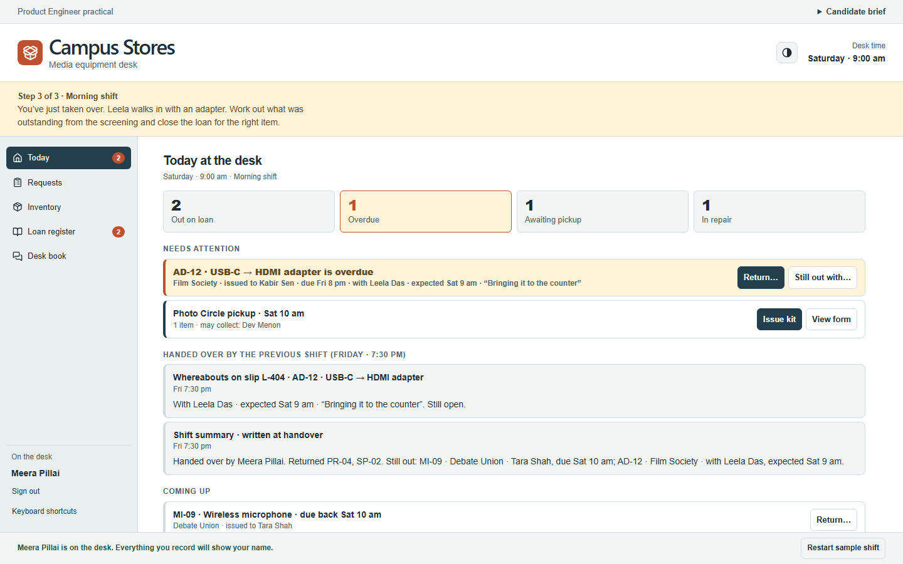
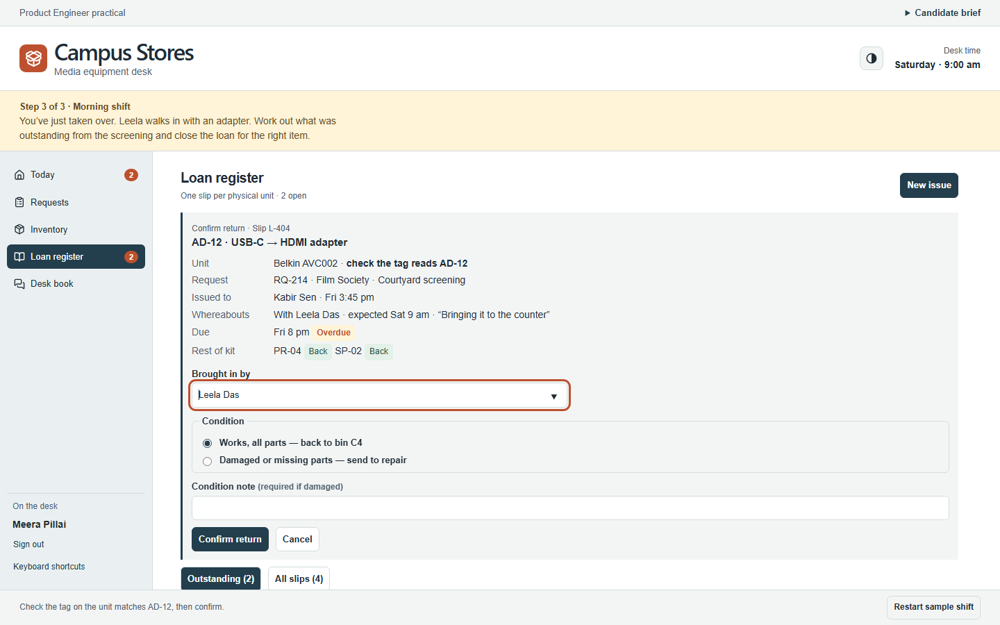
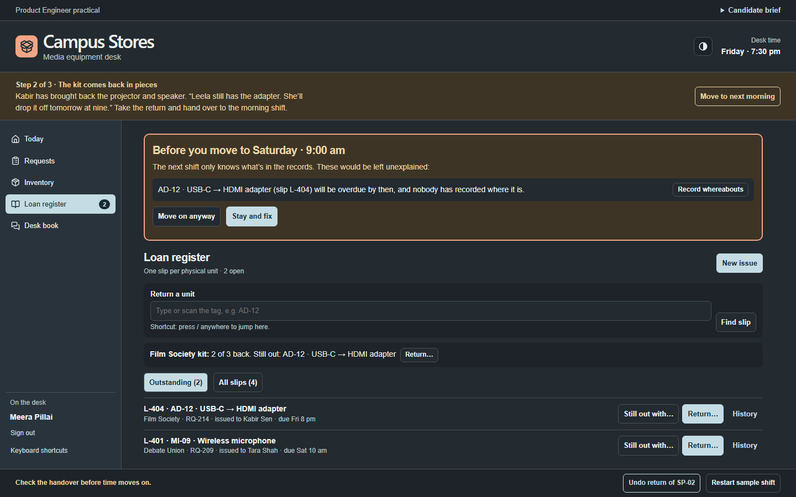
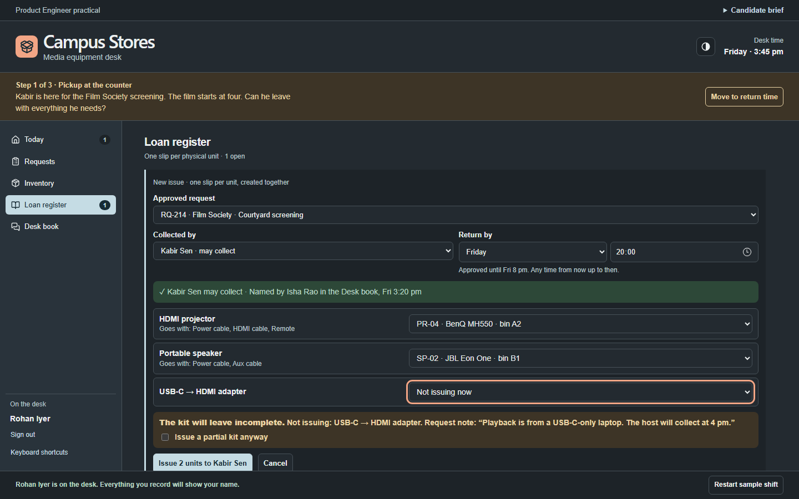

# My submission: would I keep Campus Stores?

**Yes, I'd keep it.** It gets the hard part right: it records each physical unit on its own slip and checks it against the approved request. What it gets wrong is everything around the moment a different person has to act on those records. That covers the next shift, a unit coming back with someone who isn't named on the slip, and a kit that leaves the desk incomplete. My changes are about that handover.

Open `index.html`, press **Restart sample shift** (twice), **sign in** at the bottom of the menu, and play the three steps. Each handover signs you out, so sign in again as the next shift. The ◐ button in the header switches between light (the default) and dark. Screenshots are in [`docs/`](docs/).

**Who uses it:** only the staff working the media desk. Club members like Isha, Kabir and Leela never log in. Their requests arrive already approved by the Student Activities Office, and their messages are copied into the Desk book. So staff-only actions such as adding equipment belong here.

## A moment it handles well: issuing Kabir's kit

At 3:45 pm I issued the Film Society kit to Kabir against RQ-214.
- **It wouldn't hand out a broken unit.** PR-06 (in repair) was never offered.
- **It wouldn't hand out more than approved.** When I tried to put a second speaker (SP-05) on the same request, it refused: *"The approved quantity of this equipment type is already on loan."*

Because there is **one slip per physical unit**, Friday night's partial return stayed exact. I closed the projector and speaker slips, and only the adapter slip stayed open. I kept all of this.

## A moment I'd change: Saturday 9 am, Leela's adapter

As the new morning shift, Leela handed me an adapter. The original register showed only:

- `L-404 · AD-12`: RQ-214 · Kabir Sen · Due Fri 8 pm
- `L-401 · MI-09`: RQ-209 · Tara Shah · Due Sat 10 am

**What went wrong:**
- **Codes, not items.** Nothing said "adapter" or "microphone".
- **Leela wasn't on any slip.** The slip was in Kabir's name.
- **No overdue flag.** It was 13 hours past due and nothing flagged it.
- **The why was in another tab.** The only explanation was Kabir's free-text message in the Desk book, with nothing linking it to the slip.
- **"Record return" was one irreversible click.** It never asked which unit was on the counter, and Tara's mic slip was one row away.

The records were *correct*, but acting on them depended on the new person's detective work. The night before, nothing had stopped me from moving the clock on without writing down where the adapter was.

## What I changed

The core change is that **the handover lives on the record**, and **returns start from the unit in hand**.

| Where | Change | Why |
|---|---|---|
| **Today** (new home tab) | Counts (out, overdue, awaiting pickup, in repair), a **Needs attention** list with one-click actions, **Handed over by the previous shift**, and **Coming up**. | A new shift sees what's open without searching four tabs. |
| **Moving the clock** | A **handover check** stops time moving on if a kit hasn't been issued or a slip will be overdue with no whereabouts recorded. Each problem has a **Fix** button; *Move on anyway* is still allowed. A **shift summary** is written to the Desk book automatically. | The gap that broke Saturday morning was created on Friday night. |
| **Slip whereabouts** | **Still out with…** records who has the unit and when it's expected. It shows on the slip row, on Today, on the return card and in the Desk book. | Leela's name is now on the record she's returning against. |
| **Return a unit** | Type or scan the tag (`ad12`, `AD 12` and `ad-12` all work). A confirmation card shows unit, model, "check the tag reads AD-12", request, issued to, whereabouts, overdue and the **rest of the kit**. Record **who brought it in** and **condition**. | Closing a slip becomes a check against the object, not a click on a row. |
| **Issue kit** | One form issues the whole approved kit: one unit picker per approved line, prefilled from the shelf, with bin locations. | Three repetitive forms become one, and nothing on the request gets forgotten. |
| **Collector check** | Shows whether the person is allowed to collect ("Named by Isha Rao in the Desk book, Fri 3:20 pm"). Anyone else needs an explicit "I confirmed with Isha" tick. | That authorisation lived only in a message. |
| **Incomplete kit warning** | Leaving the adapter off shows the request note (*"USB-C-only laptop"*) and needs a deliberate tick. | A projector without the adapter is useless for this screening. |
| **Undo** | The last change can be undone from the status bar: an issue, return, whereabouts, note, added unit, repair or returned part. | Mistakes at a busy counter are cheap to fix. |
| **Slip history** | Each slip has a timeline: issued → whereabouts → returned by whom, in what condition, with any missing parts. Each line records which staff member made it. | Answers "what happened to this?" without asking anyone. |
| **Damaged returns** | Choosing *Damaged or missing parts* needs a note and sends the unit to **In repair**, so it can't be issued again. | Broken kit shouldn't go back on the shelf. |
| **Inventory** | Search (code, type, model, bin, borrower), filter counts, and who has each loaned unit. | "Where's AD-12?" is one search. |
| **Add equipment** (staff) | Inventory → **Add equipment**: type (or a new type), tag code (the next free code is suggested, e.g. AD-16), model, home bin. **Mark repaired** returns a unit from the workshop to its bin. | Stock changes. The desk shouldn't need a developer to add a new adapter. |
| **Unlisted collectors** | *Collected by → Someone not listed…* lets you type a name. Typing "kabir sen" resolves to Kabir Sen. A new name always needs the "confirmed with the filer" tick, and it's remembered for later forms. *Brought in by* and *Still out with…* take typed names too. | Real counters see people who aren't in the system. |
| **Staff sign-in and signed handovers** | Staff sign in at the bottom of the menu, and nothing can be issued, returned or noted until they do. Every slip-history line records who made it. Moving the clock writes a summary that starts "Handed over by Rohan Iyer" and signs them out, so the next shift signs in to take over. | Answers "who took this return?" and makes the handover a deliberate act. |
| **Accessory checklist** | Each type lists what goes with it (projector: power cable, HDMI cable, remote). The issue form shows it, and the return card has a tick list. Anything unticked is tracked on Today as "PR-04 came back without: Remote" until **Remote returned** is clicked. | A missing remote or charger is the most common real-desk loss, and the original app couldn't record it. |
| **Keyboard shortcuts** | <kbd>/</kbd> return a unit · <kbd>N</kbd> new issue · <kbd>T</kbd> Today · <kbd>Esc</kbd> close a form. They're ignored while typing in a field and listed under the menu. | A busy counter shouldn't need a mouse. |
| **Light / dark theme** | A single ◐ button in the header. The default is light; clicking it switches to dark, and the choice is remembered in that browser. | Desks have bright counters and dim back rooms. |
| **Full-screen portal layout** | The app fills the window: full-height sidebar, header and status bar fixed, and only the work area scrolls. Phones get a top menu instead. | It's a tool people keep open all shift, not a page they read once. |
| **Requests** | A status per request (*Awaiting pickup*, *Out*, *Partly returned · 2 of 3 back*, *Returned*) and a per-item breakdown. | Kit-level view of a unit-level register. |

### Edge cases handled

- **Unknown codes.** A tag code that matches nothing is refused, with an example of the format.
- **Wrong adapter.** If Leela hands over **AD-15**, it's refused because AD-15 is on the shelf, and the message points to the open adapter slip (AD-12, Film Society, with Leela). The same check stops a unit already on the shelf or in repair from being "returned".
- **Damaged without a note.** The return is blocked until there's a note. A rejected form keeps what was typed and highlights the field.
- **Collectors.** Collecting by someone the filer didn't name is blocked until it's confirmed with the filer.
- **Return times.** *Return by* is a day plus any time you type (e.g. Fri 7:40 pm), filled in with the approved time. Empty times, times already past, and times after the approved return are refused, each with a reason. A later return needs a new approval.
- **Approval ended.** Issuing against an approval that has ended is blocked, and the request page explains why.
- **Re-issuing.** Items already out, or already returned, on a request can't be issued again.
- **Whereabouts.** *Expected back* is also any day and time up to Sunday, and must be in the future. Days that are already over are greyed out.
- **Not signed in.** Issuing, returning, notes, whereabouts, adding units, repairs and returned parts are all blocked until someone signs in. Looking a unit up still works. Signing out, or handing over, locks it again.
- **Missing parts.** A return with an unticked accessory still closes the slip and shelves the unit. The missing part stays on Today and in the shift summary until it's marked returned.
- **Shortcuts while typing.** Shortcuts are ignored inside text fields, so typing "n" in a name doesn't open a new issue.
- **Repairs.** "Mark repaired" only appears for a unit that is in repair.
- **Restart.** Restarting needs a second confirming click.
- **Adding equipment.** These are refused, each with a suggested fix:
  - a duplicate tag code
  - a malformed code (`zz`)
  - a code prefix belonging to another type (`PR-09` for an adapter)
  - a prefix that doesn't match the type's existing codes
  - a missing model or bin

  A "new" type that already exists ("portable speaker") is matched to the existing type. A unit whose type isn't on any approved request is added, with a warning that it can't be issued yet.
- **Names.** Names must be real names (letters, spaces, hyphens and apostrophes), and are tidied ("  priya   nair " → "Priya Nair").
- **Saved progress.** Saved data is checked on load (unique slip numbers, no unit open on two slips, valid times). Anything malformed starts a fresh shift instead of breaking the page.
- **Keyboard and screen readers.** Escape closes any open form. Focus moves to the new form or heading. Status messages are announced, and invalid fields are marked with `aria-invalid`.
- **Phone width.** The layout works at 390px. Both themes keep the original colour palette, and light is the default.

## The same job, with the change

1. **Fri 3:45 pm, pickup.**
   - I sign in as Rohan Iyer. Today shows *Film Society pickup · may collect: Isha Rao, Kabir Sen*. **Issue kit**.
   - I pick Kabir and the form confirms he may collect. *Return by* is filled in as Fri 8 pm (editable to any earlier time), and PR-04, SP-02 and AD-12 are pre-picked with their bins, each showing what goes with it (projector: power cable, HDMI cable, remote).
   - One click issues all three: slips L-402 to L-404.
2. **Fri 7:30 pm, partial return.**
   - In **Return a unit** I type `pr4`. The card says check the tag reads PR-04, and the rest of the kit is still out.
   - I confirm with Brought in by Kabir and condition Good, and tick off the power cable, HDMI cable and remote. I do the same for SP-02.
   - When I try to **Move to next morning**, the handover check stops me: *"AD-12 will be overdue by then, and nobody has recorded where it is."* **Fix** → *Still out with Leela Das, expected Sat 9 am*. Now I can move on. The shift summary ("Handed over by Rohan Iyer…") is written automatically, and I'm signed out.
3. **Sat 9 am, morning shift.**
   - I sign in as Meera Pillai. Today's first item is **AD-12 · USB-C → HDMI adapter is overdue**, with Leela Das, expected Sat 9 am, and the previous shift's handover is right below it.
   - Leela hands it over and I click **Return…**. The card already says *Brought in by: Leela Das* and shows PR-04 and SP-02 back.
   - I check the tag reads AD-12 and confirm. The Film Society kit shows *3 of 3 back*, and Tara's microphone is never touched.

## What I kept

- One slip per physical unit.
- The issue-time checks against the approved request and repair status.
- Inventory with home bins.
- The Desk book for messages that aren't about a loan.
- The original visual language, layout, and offline single-file setup with no libraries.

## One observation at a real counter

**When someone returns an item on a loan that isn't in their name, does the staffer close the right slip without opening the Desk book or messaging the previous shift?**

I'd time each return from the item landing on the counter to the confirmed slip, and count every "which one is this?" question. Both should drop. The case that matters most is the morning after a partial return.

## How I checked it

I tested every flow in headless Microsoft Edge with scripted runs:
- **The whole shift:** all three steps.
- **Edge cases:** the ones above, including wrong unit, unknown code, damaged return without a note, unlisted collector, past and late return times, a missing remote, signed-out actions and keyboard shortcuts.
- **Layouts:** screenshots at 1440×900 and at a 390px phone width, in both themes.

No run showed a script error. Saved progress is checked on load, so a corrupted browser save falls back to a fresh shift.

## Screenshots

| Morning shift: Today (light) | Return confirmation (light) |
|---|---|
|  |  |
| **Handover check (dark)** | **Incomplete-kit warning (dark)** |
|  |  |

Also in [`docs/`](docs/): every view in both themes, plus phone width (390px).

---

# Campus Stores

Campus Stores is a Product Engineer work sample set at a fictional campus media equipment desk. Work through a club’s screening, from equipment pickup to a partial return and the next morning’s handover. Open **Candidate brief** in the app for the assignment.

## Run the app

Open `index.html` in a modern browser. The app includes its scripts, styles, and icons and can run offline.

To serve it over local HTTP, run this from the repository folder and visit `http://localhost:8000`.

```sh
python3 -m http.server 8000 --bind 127.0.0.1
```

Each browser stores its own sample shift locally when browser storage is available. **Restart sample shift** restores the fictional starting records.

## Source

- `index.html` contains the desk layout, candidate brief, and bundled icons.
- `app.js` contains the sample records and interactions.
- `styles.css` defines the desktop and mobile layouts.

Icon license notices are in [third-party/lucide-LICENSE.txt](third-party/lucide-LICENSE.txt).


## Submit your work

1. [Fork Campus Stores](https://github.com/virinchi-healthcare/campus-stores/fork) into your GitHub account. Complete the candidate brief and push your changes to your public fork. In your README, point reviewers to your work and explain the decision you made.
2. In your fork, open **Commits**, select the final commit you want reviewed, and copy the page URL. It should look like `https://github.com/YOUR-USERNAME/campus-stores/commit/COMMIT-SHA`.
3. [Submit your work through the Google Form](https://docs.google.com/forms/d/e/1FAIpQLScvzoh1R4WS-SkiwAVBQbMvniieJYSoOEfLMyVo5CyjOvYUgQ/viewform). Your **roll number**, **email ID**, and **final commit link from your public fork** are required. Enter your roll number and email ID in the form only.
